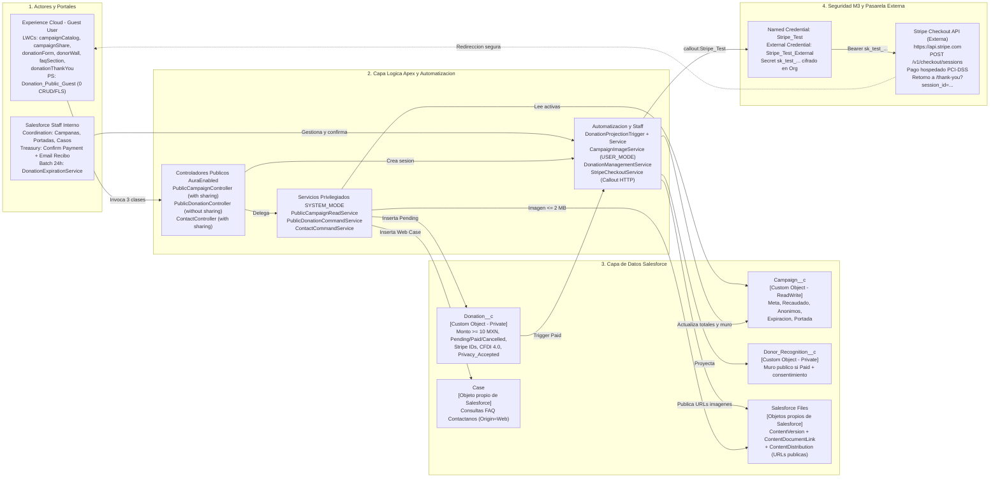

# Portal de Donaciones Mexico Dreamin

## Entregables E1

### (1) Sitio público

> **[https://empathetic-narwhal-9eroye-dev-ed.trailblaze.my.site.com/donaciones/](https://empathetic-narwhal-9eroye-dev-ed.trailblaze.my.site.com/donaciones/)**

### Sandbox de validación

El sitio `Donaciones` está activo en el Sandbox `donacionesSandbox` (`uady--class2026a`). URL pública:

> **[https://uady--class2026a.sandbox.my.site.com/donaciones/](https://uady--class2026a.sandbox.my.site.com/donaciones/)**

El Checkout del Sandbox requiere completar la Named Credential `Stripe_Test` con una clave `sk_test_...` desde Setup; no uses ni publiques claves reales.

### (2) Video demo

> **(https://josemcebuad.github.io/Donaciones-Mexico-Dreamin/)**

### (3) Tablero de backlog

[Tablero del proyecto](https://github.com/users/JoseMcebUAD/projects/8) | [Backlog completo](docs/backlog.md)

<!-- BACKLOG-START -->
[Tablero E1](https://github.com/JoseMcebUAD/Donaciones-Mexico-Dreamin/issues?q=is%3Aissue+label%3AE1) | [Tablero E2](https://github.com/JoseMcebUAD/Donaciones-Mexico-Dreamin/issues?q=is%3Aissue+label%3AE2)

| Entrega | Total | Cumplidas | Avance |
|---------|-------|-----------|--------|
| E1 | 10 | 10 | 100% (10/10) |
| E2 | 4 | 1 | 25% (1/4) |
| **Total** | **14** | **11** | **79%** |

> Calculo: issues cerradas en GitHub / total de issues x 100.

| ID | Historia | Entrega | Estado |
|----|----------|---------|--------|
| [US-D1](https://github.com/JoseMcebUAD/Donaciones-Mexico-Dreamin/issues/20) | Visualizacion publica de campanas y progreso financiero | E1 | Implementada |
| [US-D2](https://github.com/JoseMcebUAD/Donaciones-Mexico-Dreamin/issues/21) | Donacion en modalidad Anonima | E1 | Implementada |
| [US-D3](https://github.com/JoseMcebUAD/Donaciones-Mexico-Dreamin/issues/22) | Registro previo de donacion y control de expiracion | E1 | Implementada |
| [US-D4](https://github.com/JoseMcebUAD/Donaciones-Mexico-Dreamin/issues/23) | Retorno y pagina de agradecimiento con contacto de soporte | E1 | Implementada |
| [US-C1](https://github.com/JoseMcebUAD/Donaciones-Mexico-Dreamin/issues/24) | Reconocimiento publico de aportaciones en campana | E1 | Implementada |
| [US-F1](https://github.com/JoseMcebUAD/Donaciones-Mexico-Dreamin/issues/25) | Captura de datos fiscales CFDI 4.0 y visibilidad | E1 | Implementada |
| [US-S1](https://github.com/JoseMcebUAD/Donaciones-Mexico-Dreamin/issues/26) | Gestion interna de campanas y control al 100% de la meta | E1 | Implementada |
| [US-S2](https://github.com/JoseMcebUAD/Donaciones-Mexico-Dreamin/issues/27) | Consola de monitoreo y filtro de solicitudes de factura | E1 | Implementada |
| [US-S3](https://github.com/JoseMcebUAD/Donaciones-Mexico-Dreamin/issues/28) | Confirmacion manual de pago y envio de comprobante | E1 | Implementada |
| [US-V2](https://github.com/JoseMcebUAD/Donaciones-Mexico-Dreamin/issues/29) | Auditoria y prueba de seguridad para Guest User | E1 | Implementada |
| [US-D1b](https://github.com/JoseMcebUAD/Donaciones-Mexico-Dreamin/issues/30) | Donacion de monto libre personalizado | E2 | Implementada |
| [US-D5](https://github.com/JoseMcebUAD/Donaciones-Mexico-Dreamin/issues/31) | Confirmacion y comprobante automaticos via webhook | E2 | Pendiente |
| [US-V3](https://github.com/JoseMcebUAD/Donaciones-Mexico-Dreamin/issues/32) | Validacion de autenticidad e idempotencia del Webhook | E2 | Pendiente |
| [US-S4](https://github.com/JoseMcebUAD/Donaciones-Mexico-Dreamin/issues/33) | Auditoria de confirmaciones automaticas y log de avisos descartados | E2 | Pendiente |

<!-- BACKLOG-END -->

### (4) Seguridad, modelo ER y datos personales

- [Seguridad, Stripe y Experience Cloud](docs/seguridad.md)
- [Clasificación y tratamiento de datos personales (OA6)](docs/seguridad.md#4-clasificaci%C3%B3n-y-tratamiento-de-datos-personales-oa6)
- [Modelo de datos y Diagrama ER](docs/modelo_datos_er.md)

### (5) Metadata respaldada

Toda la metadata desplegada en la org está versionada en [`salesforce/force-app/`](salesforce/force-app/). Para reproducir el estado de la org:

```powershell
cd salesforce
sf project deploy start --target-org donacionesSandbox --source-dir force-app --test-level NoTestRun
```

`NoTestRun` se usó para el primer despliegue del Sandbox porque dos pruebas heredadas de correo en la org fallan por su configuración de deliverability. Ejecuta las pruebas propias del portal antes de promover cambios.

### (6) Bitácoras y registros

- [Bitácora de IA](docs/bitacora_ia.md)
- [Bitácora de contribución](docs/contribucion.md)
- Registro de preguntas y reportes: pendiente crear `docs/preguntas_y_reportes.md` (requerido para E2)

---

Portal público de donaciones para Mexico Dreamin. Permite consultar campañas activas, iniciar un donativo con Stripe Test Checkout y reconocer donantes pagados con consentimiento. La operación interna se realiza desde Salesforce.

## Alcance

**Entrega 1** — issues [#20](https://github.com/JoseMcebUAD/Donaciones-Mexico-Dreamin/issues/20)–[#29](https://github.com/JoseMcebUAD/Donaciones-Mexico-Dreamin/issues/29):

| Issue | Historia |
| :---: | :--- |
| [#20](https://github.com/JoseMcebUAD/Donaciones-Mexico-Dreamin/issues/20) | US-D1 — Visualización pública de campañas y progreso financiero |
| [#21](https://github.com/JoseMcebUAD/Donaciones-Mexico-Dreamin/issues/21) | US-D2 — Donación en modalidad anónima |
| [#22](https://github.com/JoseMcebUAD/Donaciones-Mexico-Dreamin/issues/22) | US-D3 — Registro previo de donación y control de expiración |
| [#23](https://github.com/JoseMcebUAD/Donaciones-Mexico-Dreamin/issues/23) | US-D4 — Retorno y página de agradecimiento con contacto de soporte |
| [#24](https://github.com/JoseMcebUAD/Donaciones-Mexico-Dreamin/issues/24) | US-C1 — Reconocimiento público de aportaciones en campaña |
| [#25](https://github.com/JoseMcebUAD/Donaciones-Mexico-Dreamin/issues/25) | US-F1 — Captura de datos fiscales CFDI 4.0 y visibilidad |
| [#26](https://github.com/JoseMcebUAD/Donaciones-Mexico-Dreamin/issues/26) | US-S1 — Gestión interna de campañas y control al 100% de la meta |
| [#27](https://github.com/JoseMcebUAD/Donaciones-Mexico-Dreamin/issues/27) | US-S2 — Consola de monitoreo y filtro de solicitudes de factura |
| [#28](https://github.com/JoseMcebUAD/Donaciones-Mexico-Dreamin/issues/28) | US-S3 — Confirmación manual de pago y envío de comprobante |
| [#29](https://github.com/JoseMcebUAD/Donaciones-Mexico-Dreamin/issues/29) | US-V2 — Auditoría y prueba de seguridad para Guest User |

**Entrega 2** — issues [#30](https://github.com/JoseMcebUAD/Donaciones-Mexico-Dreamin/issues/30)–[#33](https://github.com/JoseMcebUAD/Donaciones-Mexico-Dreamin/issues/33) + mejoras post-feedback/UX: monto libre (`US-D1b`), portada de campaña (`US-S5`), compartir y deep-link (`US-D1c`), refactor de reconocimiento e imagen vía Files (`US-R1`/`US-R2`), FAQ y contacto vía `Case` (`US-UX1`/`US-UX2`), aviso de privacidad (`issue-45`), y pendientes de cierre E2 (`US-D5` webhook, `US-V3` HMAC/idempotencia, `US-S4` auditoría).

## Arquitectura e Infraestructura

Vista general de los portales, capa lógica Apex, integración segura con Stripe Checkout API y separación entre **Custom Objects** y **Objetos propios de Salesforce**. El modelo ER simplificado (UML) y el diccionario completo de campos se detallan en [docs/modelo_datos_er.md](docs/modelo_datos_er.md).



## Estructura

```text
salesforce/
  force-app/main/default/
    classes/
      PublicCampaignController       Campañas activas y muro para el sitio público
      PublicCampaignReadService      Lectura SYSTEM_MODE para catálogo y muro
      PublicDonationController       Creación de donaciones (>= $10 MXN) y sesión Stripe
      PublicDonationCommandService   Registro Pending, privacidad e imagen vía ContentDistribution
      ContactController              Validación del formulario Contáctanos
      ContactCommandService          Inserción SYSTEM_MODE de Case (Origin = Web)
      CampaignImageService           Publicación de portada de campaña (staff)
      DonationProjectionService      Recálculo de Campaign__c y proyección Donor_Recognition__c
      DonationManagementService      Confirmación manual de pago y comprobante por correo
      DonationExpirationService      Batch/Schedulable que expira donaciones abandonadas
      StripeCheckoutService          Callout a Stripe Test Checkout API
      *Test.cls                      8 clases de prueba Apex + DonationTestDataFactory
    lwc/
      campaignCatalog                Catálogo público, navegación HOME/FAQ y deep-link
      campaignShare                  Popup de compartir campaña en redes y enlace
      campaignImageUpload            Carga de imagen de portada en Campaign__c (staff)
      donationForm                   Formulario: anónimo, crédito, factura CFDI 4.0, privacidad
      donationConfirmation           Acción de Tesorería — Confirm Payment
      donationThankYou               Página de agradecimiento segura
      donorWall                      Muro de reconocimiento público
      faqSection                     Preguntas frecuentes y formulario Contáctanos
    objects/
      Campaign__c                    Meta, fecha de expiración, portada, donaciones adicionales
      Donation__c                    Estado, modalidad, campos CFDI 4.0, privacidad
      Donor_Recognition__c           Proyección pública de donantes con consentimiento
    permissionsets/
      Donation_Coordination          Acceso de coordinación
      Donation_Treasury              Acceso de tesorería
      Donation_Public_Guest          Mínimo privilegio para Guest User (0 CRUD/FLS, 3 clases Apex)
    triggers/
      DonationProjectionTrigger      Sincronización de Campaign__c y Donor_Recognition__c
    tabs/                            Tabs de Campaign__c y Donation__c
    sharingRules/                    Reglas de compartición (excluidas en .forceignore hasta configurar sitio)
    assignmentRules/                 Regla de asignación de Case (excluida en .forceignore hasta configurar org)
docs/
  backlog.md                         Historias de usuario, criterios Gherkin y alcance adicional E2
  seguridad.md                       Configuración Experience Cloud, permisos Guest User y OA6
  modelo_datos_er.md                 Diagrama ER Mermaid, diccionario de datos y reglas
  contribucion.md                    Registro de contribuciones del equipo (E1 y E2)
  e1-implementation-status.md        IDs de deploy y resultados de verificación E1
  qa-us-d1.md                        Plan y reporte QA de US-D1c
  code_analyzer.md                   Reporte de Salesforce Code Analyzer y justificación (S14 / C6)
  stripe-test-setup.md               Guía de configuración segura de Stripe Test
  bitacora_ia.md                     Bitácora cronológica de uso de IA (Entradas 01–18)
  index.html                         Página estática para GitHub Pages
scripts/
  create_issues.ps1                  Crea los issues del backlog en GitHub
  update_backlog.ps1                 Actualiza subtareas y % de avance en README
```

## Requisitos y ejecución

- Salesforce CLI (`sf`), Node.js LTS.
- Org autorizada localmente: `sf org login web --alias jDiaz`.
- My Domain y Digital Experiences habilitados en la org.
- Named Credential `Stripe_Test` apuntando a `https://api.stripe.com` con la clave `sk_test_...` guardada solo en la org, nunca en Git.

```powershell
cd salesforce
npm install
npm run lint
npm run code-analyzer
npm test
sf project deploy start --target-org jDiaz --source-dir force-app
```

Tras el despliegue, sigue [docs/seguridad.md](docs/seguridad.md) para publicar el sitio Experience Cloud, colocar los LWC y aplicar el mínimo privilegio de Guest User.

## Pruebas

- **Entrega 1 (snapshot):** 6/6 pruebas dirigidas aprobadas con 92% de cobertura en `jDiaz` (ver [docs/e1-implementation-status.md](docs/e1-implementation-status.md)).
- **Estado actual (Entrega 2 en `feat-FAQ`, desplegado en `mi-org`):** ESLint `0` errores, Salesforce Code Analyzer **`0` hallazgos High** (`10 → 0`, ver [docs/code_analyzer.md](docs/code_analyzer.md)), LWC Jest `3/3` suites (`17/17` tests pasando), y `RunLocalTests` en `mi-org` (`0Afbm00000og5EdCAI`) con **49/49 pruebas Apex aprobadas** (`78/78` componentes desplegados). Ver detalle en [docs/bitacora_ia.md](docs/bitacora_ia.md).
