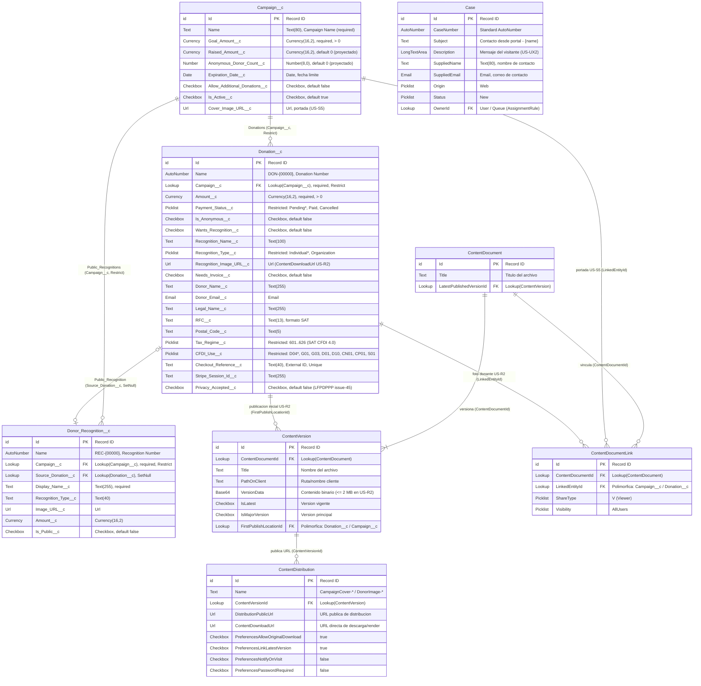

# Modelo de Datos y Diagrama Entidad-Relación (ER)

**Proyecto:** Portal de Donaciones para Mexico Dreamin  
**Programa:** SF Vibe Lab (UADY × Salesforce, Mérida)  
**Última actualización:** 18 de noviembre de 2026  
**Fuente verificada:** `salesforce/force-app/main/default/` (`objects/`, `triggers/`, `classes/`, `sharingRules/`, `permissionsets/`, `assignmentRules/`)  
**Documentos relacionados:** [Backlog](backlog.md) · [Seguridad y Datos Personales](seguridad.md) · [Contribución](contribucion.md)

---

## 1. Diagrama Entidad-Relación (Mermaid `erDiagram`)

El siguiente diagrama representa 1:1 los objetos personalizados (`Campaign__c`, `Donation__c`, `Donor_Recognition__c`) y los objetos estándar de Salesforce utilizados activamente en la solución (`Case`, `ContentDocument`, `ContentVersion`, `ContentDocumentLink`, `ContentDistribution`).

> **Nota sobre objetos estándar independientes:** `Case` no posee relación directa (`Lookup`/`Master-Detail`) hacia `Campaign__c` ni `Donation__c`; atiende consultas generales enviadas desde el formulario de contacto en la pestaña **FAQ** (`US-UX2`).

---

## 2. Diccionario de Objetos y Campos

### 2.1 `Campaign__c` (`Campaign` / `Campaigns`)

- **Archivo:** `salesforce/force-app/main/default/objects/Campaign__c/Campaign__c.object-meta.xml`
- **Name Field:** `Name` (`Campaign Name`, `Text(80)`)
- **OWD (`sharingModel`):** `ReadWrite` · **Reportes habilitados (`enableReports`):** `true` · **Estado:** `Deployed`

| Campo API | Etiqueta | Tipo / Longitud o Precisión | Requerido / Default | Descripción funcional |
| :--- | :--- | :--- | :--- | :--- |
| `Name` | Campaign Name | `Text(80)` | Requerido | Nombre público de la campaña de recaudación. |
| `Goal_Amount__c` | Goal Amount | `Currency(16,2)` | Requerido | Meta económica en MXN. Validada `> 0`. |
| `Raised_Amount__c` | Raised Amount | `Currency(16,2)` | Default `0` | Suma proyectada de `Donation__c.Amount__c` donde `Payment_Status__c = 'Paid'`. |
| `Anonymous_Donor_Count__c` | Anonymous Donor Count | `Number(8,0)` | Default `0` | Conteo proyectado de donaciones `Paid` con `Is_Anonymous__c = true`. |
| `Expiration_Date__c` | Fecha de expiración | `Date` | Opcional | Fecha límite; si es anterior a `Date.today()`, bloquea nuevas donaciones. |
| `Allow_Additional_Donations__c` | Permitir donaciones adicionales | `Checkbox` | Default `false` | Permite seguir recibiendo donativos tras alcanzar el 100 % de la meta mientras no haya expirado. |
| `Is_Active__c` | Is Active | `Checkbox` | Default `true` | Controla si la campaña es visible en el portal público (`PublicCampaignReadService`). |
| `Cover_Image_URL__c` | Cover Image URL | `Url` | Opcional | URL pública generada vía `ContentDistribution` (`CampaignImageService`, `US-S5`). |

### 2.2 `Donation__c` (`Donation` / `Donations`)

- **Archivo:** `salesforce/force-app/main/default/objects/Donation__c/Donation__c.object-meta.xml`
- **Name Field:** `Name` (`Donation Number`, `AutoNumber`, formato `DON-{00000}`)
- **OWD (`sharingModel`):** `Private` · **Reportes habilitados (`enableReports`):** `true` · **Estado:** `Deployed`
- **Vistas de lista (`listViews`):** `Pending_Donations` (`Payment_Status__c = 'Pending'`) e `Invoice_Requests` (`Needs_Invoice__c = 1`).

| Campo API | Etiqueta | Tipo / Longitud o Precisión | Requerido / Default | Descripción funcional |
| :--- | :--- | :--- | :--- | :--- |
| `Name` | Donation Number | `AutoNumber` (`DON-{00000}`) | Sistema | Folio único de la donación. |
| `Campaign__c` | Campaign | `Lookup(Campaign__c)` | Requerido (`Restrict`) | Campaña asociada (`Donations`). |
| `Amount__c` | Amount | `Currency(16,2)` | Requerido | Monto en MXN. En UI/Apex público exige `>= 10.00 MXN` (`US-D1b`). |
| `Payment_Status__c` | Payment Status | `Picklist` (restringido) | Default `Pending` | Valores: `Pending`, `Paid`, `Cancelled`. |
| `Is_Anonymous__c` | Is Anonymous | `Checkbox` | Default `false` | Oculta la identidad del donante en vistas públicas (`Donor_Name__c = null`). |
| `Wants_Recognition__c` | Wants Recognition | `Checkbox` | Default `false` | Consentimiento para proyectar en `Donor_Recognition__c`. |
| `Recognition_Name__c` | Public Recognition Name | `Text(100)` | Opcional | Nombre o alias público mostrado en el muro. |
| `Recognition_Type__c` | Public Recognition Type | `Picklist` (restringido) | Default `Individual` | Valores: `Individual`, `Organization`. Omitido en el formulario público por `US-R1`; `PublicDonationCommandService` fija `'Individual'` cuando `Wants_Recognition__c = true`. |
| `Recognition_Image_URL__c` | Public Recognition Image URL | `Url` | Opcional | URL de descarga de imagen subida en `donationForm` (`US-R2`), generada vía `ContentDistribution`. |
| `Needs_Invoice__c` | Needs Invoice | `Checkbox` | Default `false` | Indica solicitud de factura CFDI 4.0 (independiente de `Is_Anonymous__c`). |
| `Donor_Name__c` | Donor Name | `Text(255)` | Opcional | Nombre del donante (`null` si `Is_Anonymous__c = true`). |
| `Donor_Email__c` | Donor Email | `Email` | Opcional (obligatorio en flujo público) | Correo electrónico para envío de comprobante interno. |
| `Legal_Name__c` | Legal Name | `Text(255)` | Condicional (si factura) | Nombre o razón social fiscal. |
| `RFC__c` | RFC | `Text(13)` | Condicional (si factura) | Registro Federal de Contribuyentes validado por regex SAT. |
| `Postal_Code__c` | Código Postal | `Text(5)` | Condicional (si factura) | Código postal del domicilio fiscal CFDI 4.0. |
| `Tax_Regime__c` | Régimen Fiscal | `Picklist` (restringido) | Condicional (si factura) | Claves SAT: `601`, `603`, `605`, `606`, `608`, `612`, `616`, `621`, `625`, `626`. |
| `CFDI_Use__c` | Uso del CFDI | `Picklist` (restringido) | Default `D04` | Claves SAT: `D04`, `G01`, `G03`, `D01`, `D10`, `CN01`, `CP01`, `S01`. |
| `Checkout_Reference__c` | Checkout Reference | `Text(40)` | `External ID`, `Unique` | Referencia generada por servidor (`MD-<random>`) enviada a Stripe (`client_reference_id` y `metadata[salesforce_reference]`). |
| `Stripe_Session_Id__c` | Stripe Session ID | `Text(255)` | Opcional | Identificador `cs_test_...` de la sesión de Stripe Checkout. |
| `Privacy_Accepted__c` | Privacy Accepted | `Checkbox` | Default `false` | Registra la aceptación explícita del Aviso de Privacidad LFPDPPP (`issue-45`), validada en `donationForm` y `PublicDonationController` y persistida por `PublicDonationCommandService`. |

### 2.3 `Donor_Recognition__c` (`Donor Recognition` / `Donor Recognitions`)

- **Archivo:** `salesforce/force-app/main/default/objects/Donor_Recognition__c/Donor_Recognition__c.object-meta.xml`
- **Name Field:** `Name` (`Recognition Number`, `AutoNumber`, formato `REC-{00000}`)
- **OWD (`sharingModel`):** `Private` · **Estado:** `Deployed`

| Campo API | Etiqueta | Tipo / Longitud o Precisión | Requerido / Default | Descripción funcional |
| :--- | :--- | :--- | :--- | :--- |
| `Name` | Recognition Number | `AutoNumber` (`REC-{00000}`) | Sistema | Folio de la proyección pública. |
| `Campaign__c` | Campaign | `Lookup(Campaign__c)` | Requerido (`Restrict`) | Campaña a la que pertenece el muro (`Public_Recognitions`). |
| `Source_Donation__c` | Source Donation | `Lookup(Donation__c)` | Opcional (`SetNull`) | Donación origen (`Public_Recognition`), nunca expuesta al portal público. |
| `Display_Name__c` | Display Name | `Text(255)` | Requerido | Nombre público (`Recognition_Name__c`, o `Donor_Name__c` como respaldo). |
| `Recognition_Type__c` | Recognition Type | `Text(40)` | Opcional | Tipo de reconocimiento proyectado (`'Individual'` por defecto). |
| `Image_URL__c` | Image URL | `Url` | Opcional | URL pública copiada de `Donation__c.Recognition_Image_URL__c`. |
| `Amount__c` | Amount | `Currency(16,2)` | Opcional | Importe mostrado en el muro público. |
| `Is_Public__c` | Is Public | `Checkbox` | Default `false` | Solo `true` cuando la donación está `Paid`, no es anónima y tiene consentimiento. |

### 2.4 Objetos Estándar Integrados (`Case` y Salesforce Files)

| Objeto | Uso en el portal | Campos / Relaciones relevantes |
| :--- | :--- | :--- |
| `Case` | Formulario **Contáctanos** en FAQ (`US-UX2`, `ContactController` -> `ContactCommandService`) | `Subject` (`'Contacto desde portal - ' + name`), `Description`, `SuppliedName`, `SuppliedEmail`, `Origin = 'Web'`, `Status = 'New'`. |
| `ContentVersion` | Carga de archivos (`US-S5` portada vía LWC estándar y `US-R2` foto donante vía Base64 `<= 2 MB`) | `Title`, `PathOnClient`, `VersionData`, `ContentDocumentId`, `FirstPublishLocationId` (en `US-R2` apunta a `Donation__c`). |
| `ContentDocument` | Contenedor lógico de cada archivo subido | `Id`, `Title`, `LatestPublishedVersionId`. |
| `ContentDocumentLink` | Vincula archivos con `Campaign__c` (`US-S5`) o `Donation__c` (`US-R2`, automático por `FirstPublishLocationId`) | `ContentDocumentId`, `LinkedEntityId`, `ShareType`, `Visibility`. |
| `ContentDistribution` | Publica enlace externo seguro para mostrar imágenes en Experience Cloud sin autenticar | `Name` (`CampaignCover-*` / `DonorImage-*`), `ContentVersionId`, `ContentDownloadUrl`, `DistributionPublicUrl`, `PreferencesAllowOriginalDownload = true`, `PreferencesLinkLatestVersion = true`, `PreferencesNotifyOnVisit = false`, `PreferencesPasswordRequired = false`. |

---

## 3. Reglas de Validación (Metadata)

| Objeto | Regla API | Estado | Fórmula (`errorConditionFormula`) | Mensaje de error |
| :--- | :--- | :---: | :--- | :--- |
| `Campaign__c` | `Goal_Must_Be_Positive` | **Activa** (`true`) | `Goal_Amount__c <= 0` | `Goal amount must be greater than zero.` |
| `Donation__c` | `Amount_Must_Be_Positive` | **Activa** (`true`) | `Amount__c <= 0` | `Donation amount must be greater than zero.` |
| `Donation__c` | `Invoice_Data_Required` | **Activa** (`true`) | `AND(Needs_Invoice__c, OR(ISBLANK(Legal_Name__c), NOT(REGEX(UPPER(RFC__c), "[A-Z&]{3,4}[0-9]{6}[A-Z0-9]{3}")), ISBLANK(Postal_Code__c), ISBLANK(TEXT(Tax_Regime__c)), ISBLANK(TEXT(CFDI_Use__c))))` | `Invoice requests require a legal name, valid RFC, postal code, tax regime, and CFDI use.` |
| `Donation__c` | `Anonymous_Cannot_Invoice` | **Inactiva** (`false`) | `AND(Is_Anonymous__c, Needs_Invoice__c)` | `Anonymous donations cannot request an invoice.` *(Desactivada desde E1 v2 para desacoplar anonimato público y solicitud de factura).* |

---

## 4. Comportamiento de `DonationProjectionTrigger` y `DonationProjectionService`

El desacople entre datos sensibles (`Donation__c`) y métricas públicas (`Campaign__c` y `Donor_Recognition__c`) se mantiene sincronizado mediante automatización declarativa/Apex:

1. **Trigger `DonationProjectionTrigger` (`Donation__c`):**
   - Eventos: `after insert, after update, after delete, after undelete`.
   - Recopila todos los `Campaign__c` afectados de `Trigger.new` (o `Trigger.old` en `delete`) y también los `Campaign__c` anteriores en `after update` (por si cambia la campaña asignada).
   - Invoca `DonationProjectionService.synchronize(campaignIds)`.
2. **Servicio `DonationProjectionService` (`public without sharing class`):**
   - Consulta las donaciones de las campañas afectadas y **filtra estrictamente `Payment_Status__c == 'Paid'`** (las donaciones `Pending` y `Cancelled` nunca suman a la campaña ni aparecen en el muro).
   - Recalcula en `Campaign__c`:
     - `Raised_Amount__c`: suma de `Amount__c` de donaciones `Paid`.
     - `Anonymous_Donor_Count__c`: cantidad de donaciones `Paid` con `Is_Anonymous__c = true`.
   - Sincroniza `Donor_Recognition__c` por campaña:
     - Crea o actualiza un registro `Donor_Recognition__c` únicamente para donaciones `Paid` con `Is_Anonymous__c = false` y `Wants_Recognition__c = true`, copiando únicamente `Campaign__c`, `Display_Name__c` (`Recognition_Name__c` o `Donor_Name__c`), `Recognition_Type__c` (`'Individual'` si viene vacío), `Image_URL__c`, `Amount__c` e `Is_Public__c = true`.
     - Elimina cualquier `Donor_Recognition__c` existente cuya donación origen haya dejado de cumplir estas condiciones o tenga `Source_Donation__c = null`.

---

## 5. Resumen del Modelo OWD, Sharing y Permisos

| Objeto | OWD (`sharingModel`) | Reglas de Compartición (`sharingRules`) | Acceso en `Donation_Public_Guest` | Acceso Staff (`Donation_Coordination` / `Donation_Treasury`) |
| :--- | :---: | :--- | :--- | :--- |
| `Campaign__c` | `ReadWrite` | `Active_Campaigns_for_Guests` (`Is_Active__c = true`, `Read` a `Donaciones_Mexico_Dreamin`) — *excluida en `.forceignore`* | **0 CRUD / 0 FLS** (lectura pública vía `PublicCampaignController` -> `PublicCampaignReadService` en `SYSTEM_MODE`) | **Coordination:** Create, Read, Edit, View All (sin Delete). **Treasury:** sin acceso directo configurado en PS. |
| `Donation__c` | `Private` | Ninguna (nunca se comparte con Guest User) | **0 CRUD / 0 FLS** (creación controlada solo en estado `Pending` vía `PublicDonationController` -> `PublicDonationCommandService` en `SYSTEM_MODE`) | **Coordination:** Read, View All (solo lectura de campos). **Treasury:** Read, Edit, View All (puede editar `Payment_Status__c` y ejecutar `DonationManagementService`). |
| `Donor_Recognition__c` | `Private` | `Public_Recognitions_for_Guests` (`Is_Public__c = true`, `Read` a `Donaciones_Mexico_Dreamin`) — *excluida en `.forceignore`* | **0 CRUD / 0 FLS** (lectura pública vía `PublicCampaignReadService` en `SYSTEM_MODE`) | **Coordination:** Read, View All (campos públicos proyectados). **Treasury:** sin acceso configurado en PS. |
| `Case` | Estándar de org | `Case.assignmentRules-meta.xml` (`Portal_Contact_Assignment`, `Origin = Web`) — *excluida en `.forceignore`* | **0 CRUD / 0 FLS** (inserción controlada vía `ContactController` -> `ContactCommandService` en `SYSTEM_MODE`) | Gestión interna estándar de Salesforce para coordinación/soporte. |
